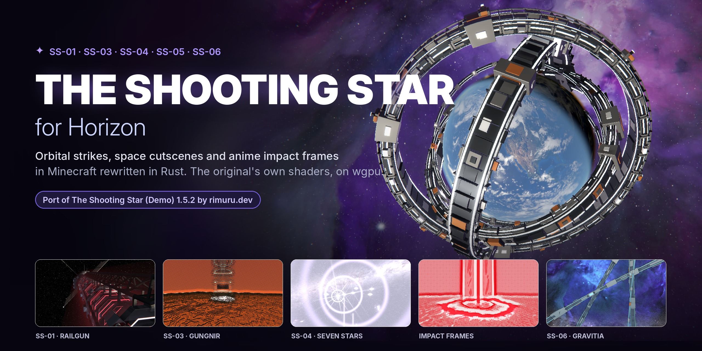
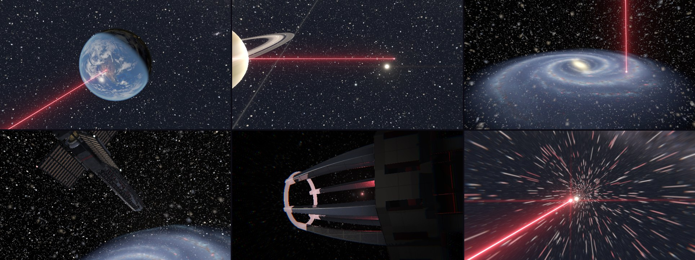
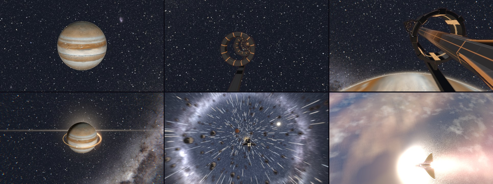
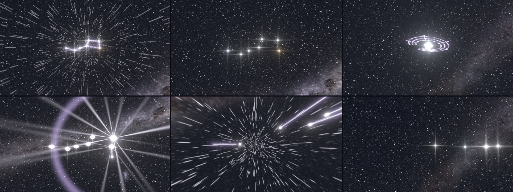
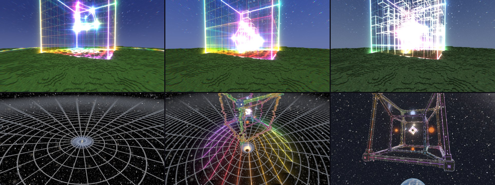
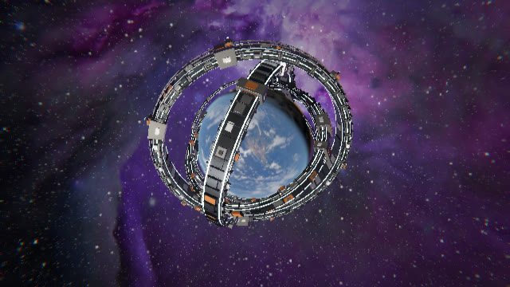
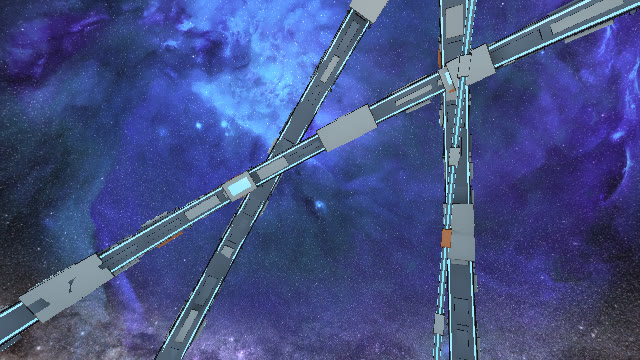
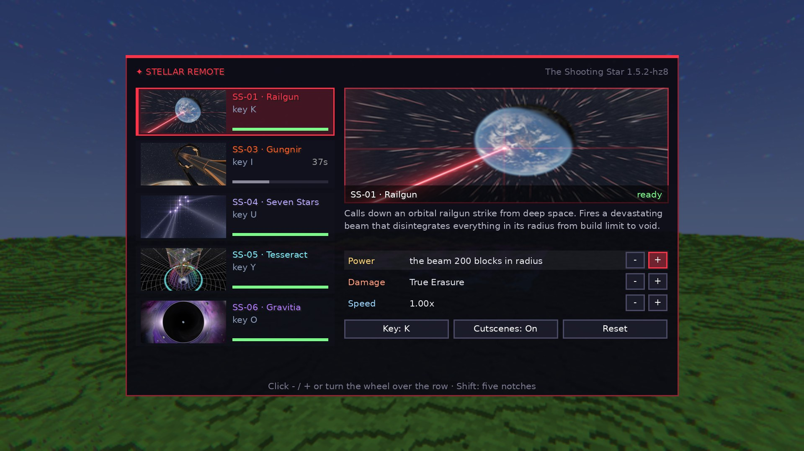

<div align="center">



# ✦ The Shooting Star — for Horizon

**Орбитальные удары, кинематографичные катсцены в космосе и аниме-кадры удара —
в Minecraft, переписанном на Rust.**

Порт мода [The Shooting Star (Demo) 1.5.2](https://www.curseforge.com/minecraft/mc-mods/the-shooting-star-demo)
(автор — **rimuru.dev**) на [Horizon](https://github.com/horizon-rust/horizon).

[Установка](#-установка) · [Управление](#-управление) · [Заклинания](#-заклинания) ·
[Что лучше оригинала](#-что-лучше-оригинала) · [Как это устроено](#-как-это-устроено) · [English](#english)

</div>

---

## ✦ Что это

Пульт **Stellar Remote** вызывает удары с орбиты. Пока удар готовится, камера
улетает в космос: Земля, Сатурн, Солнечная система, Млечный Путь, рельсовая
пушка в 58 000 световых лет. Потом возвращается к удару, и наступает конец
света: кратеры, лава, вольфрамовые шпили до неба, ударные волны.

Эффекты рисуют **собственные GLSL-шейдеры оригинала**. Они компилируются прямо
в игре через naga, встроенный в Horizon, и проходят ту же цепочку, что и в
Java-версии: проходы заклинания → блум → композит. Движение камеры в космосе
снято с кода оригинала 1.5.2 кадр за кадром.

<table>
<tr>
<td></td>
</tr>
<tr><td align="center"><b>SS-01 · Railgun</b> — от Земли до рельсовой пушки на краю Галактики и обратно</td></tr>
<tr>
<td></td>
</tr>
<tr><td align="center"><b>SS-03 · Gungnir</b> — кольцо-ускоритель у Юпитера разгоняет копьё</td></tr>
<tr>
<td></td>
</tr>
<tr><td align="center"><b>SS-04 · Seven Stars</b> — звёзды Большой Медведицы срываются с неба</td></tr>
<tr>
<td></td>
</tr>
<tr><td align="center"><b>SS-05 · Tesseract</b> — клетки, кубы в небе, гиперкуб; в катсцене — двигатель над сеткой пространства</td></tr>
<tr>
<td></td>
</tr>
<tr><td align="center"><b>SS-06 · Gravitia</b> — двадцать колец защёлкиваются вокруг Земли, и машина стреляет</td></tr>
<tr>
<td></td>
</tr>
<tr><td align="center"><b>SS-06 · Gravitia</b> — машина висит в небе над миром ещё сто секунд</td></tr>
</table>

## ✦ Установка

Нужен **[Horizon Launcher](https://github.com/horizon-rust/horizon)**. Всё делается в нём, без консоли:

1. **Моды → Добавить нативный мод с GitHub** → вставь ссылку
   ```
   https://github.com/Oxyg1/shooting-star-horizon
   ```
   → **Добавить с GitHub**.
2. **Собрать** (производительная сборка). Первая сборка занимает 20–30 минут, следующие — минуты.
3. **Играть** → зайди в любой мир. Мод сам скачает оригинал с CurseForge
   (≈145 МБ, прогресс виден над хотбаром), соберёт из него контент и
   напишет в чат, когда закончит. Эффекты работают сразу.
4. **Перезапусти игру** — появятся пульт **Stellar Remote**, блоки и звуки
   (в креативе или `/give @s shooting_star_demo:stellar_remote`).

Обновление — кнопка **Обновить** в том же списке модов.

> В репозитории **нет ни одного файла оригинала**. Мод скачивает их у тебя
> на компьютере с CurseForge и сверяет контрольные суммы, как если бы ты
> скачал мод сам.

<details>
<summary><b>Установка одной командой (без окна лаунчера)</b></summary>

Делает то же самое, включая сборку. Windows (PowerShell):

```powershell
irm https://raw.githubusercontent.com/Oxyg1/shooting-star-horizon/main/install/install.ps1 | iex
```

Linux / macOS:

```bash
curl -fsSL https://raw.githubusercontent.com/Oxyg1/shooting-star-horizon/main/install/install.sh | bash
```

</details>

<details>
<summary><b>Если CurseForge недоступен или катсцен нет</b></summary>

* **CurseForge недоступен:** задай переменную `SHOOTING_STAR_MIRROR` — адрес
  папки с теми же двумя jar. Мод проверит их по SHA-256. Для прокси
  используется `HTTPS_PROXY`.
* **Катсцен нет:** для их таблиц нужна Java 25. Она появляется вместе с
  любой версией 26.x в Horizon Launcher или Minecraft Launcher. После её
  установки мод сделает таблицы при следующем запуске.
* Удаление: `horizon-launcher mods remove shooting_star`, затем папка
  `horizon-mods/shooting_star_demo` в папке игры (`%APPDATA%\horizon` или `~/.local/share/horizon`).

</details>

## ✦ Управление

| Клавиша | Действие |
|---|---|
| **ПКМ** с пультом | каст выбранного заклинания |
| **Shift + ПКМ** | следующее заклинание |
| **H** | меню пульта: выбор заклинания, мощность, урон, скорость, клавиши (колесо, стрелки) |
| **J** | пропустить катсцену; если её нет — включить или выключить катсцены |
| **K · I · U · Y · O** | SS-01 · SS-03 · SS-04 · SS-05 · SS-06 |
| **N · M · Z** | мощность · скорость · урон выбранного заклинания (с Shift — вниз) |

Клавиши меняются в меню пульта (H) или в Options → Mods → The Shooting Star.



## ✦ Заклинания

| | Что делает | Катсцена |
|---|---|---|
| **SS-01 · Railgun** | через ≈17,6 с луч радиусом 200 вырезает цилиндр от неба до пустоты, бедрок тоже | ✅ космос, пушка, погоня |
| **SS-03 · Gungnir** | игла с орбиты: кратер 88×108, трещины лавы, вольфрамовый шпиль до неба, ударная волна | ✅ Юпитер, кольцо, полёт |
| **SS-04 · Seven Stars** | семь звёзд Ковша падают по очереди: кратеры с кристаллами и светящиеся траншеи | ✅ созвездие, залп |
| **SS-05 · Tesseract** | квадрат 640×640: 64 куба земли поднимаются в небо волнами, над ними поворачивается гиперкуб | ✅ сетка пространства, двигатель |
| **SS-06 · Gravitia** | кольцевая машина собирается вокруг Земли, бьёт, и мир навсегда становится Imaginary Space — город в пустоте под космическим небом. Нужен **второй клик** за 10 с | ✅ Земля, сборка машины, выстрел |

## ✦ Что лучше оригинала

* **16-битный HDR между проходами** вместо 8-битного: свечение без полос.
* **Полное разрешение эффектов до 1440p.** Оригинал понижал его уже выше 2,3 Мп.
* **Gravitia не сработает случайно**: нужен второй клик за 10 секунд.
* **Установка одной кнопкой в лаунчере**: мод сам достаёт файлы оригинала при первом запуске.

## ✦ Как это устроено

```
native/       код порта на Rust (native-мод Horizon, horizon-mixins)
  runtime.rs    окно: клавиши, меню, HUD, звук, режиссёр катсцен
  spells.rs     сервер: касты, таймлайны, вырезание земли, урон
  visuals.rs    что рисовать в этом кадре (StarFx, GungnirFx, SevenStarsFx)
  films.rs      космические сцены по таблицам 1.5.2
  cutscenes.rs  пути камеры катсцен (Shot, Cutscene, CutsceneDirector)
  tesseract.rs  SS-05: квадрат, кубы, гиперкуб, двигатель, катсцена
  gravitia.rs   SS-06: кольцевая машина, небо, купола, катсцена, звук
  glsl.rs       GLSL оригинала → naga (раскладка uniform-ов, sampler2D, порядок функций)
  render.rs     цепочка на wgpu: кадр мира → проходы → блум → композит
  setup.rs      первый запуск: скачать оригинал, собрать контент-мод, снять катсцены
  data/         свои файлы контент-мода, манифест файлов оригинала, рекордер катсцен
install/      установщики одной командой
tools/films/  снимает uniform-ы катсцен с классов оригинала (запускается установщиком)
```

Подробно об изменениях — в [CHANGELOG.md](CHANGELOG.md), об игре — в [docs/ГАЙД.md](docs/ГАЙД.md).

## ✦ Права

* **Оригинальный мод** — © rimuru.dev, All Rights Reserved. Его файлы не
  распространяются через этот репозиторий: установщик скачивает их с
  CurseForge на твой компьютер. Если ты автор и хочешь что-то изменить —
  открой issue.
* **Код порта** (всё в этом репозитории) — [MIT](LICENSE).
* Текстуры Земли, Луны, планет и Млечного Пути в оригинале — NASA / ESA
  (см. [NOTICE.md](NOTICE.md)).

---

## English

**The Shooting Star for Horizon** ports rimuru.dev's *The Shooting Star (Demo)
1.5.2* to [Horizon](https://github.com/horizon-rust/horizon), Minecraft Java
Edition rewritten in Rust. The spells, their world-scale destruction and
their space cutscenes are drawn by the original's own GLSL shaders. Horizon's
naga compiles them in-game, and they run in a 16-bit HDR chain on wgpu.

This repository holds only the port's code. Add it in Horizon Launcher
(Mods → Add a native mod from GitHub → `https://github.com/Oxyg1/shooting-star-horizon`),
build, and enter a world: the mod downloads the original from CurseForge and
builds its content mod on your machine; restart once. Or, from a terminal:

```powershell
irm https://raw.githubusercontent.com/Oxyg1/shooting-star-horizon/main/install/install.ps1 | iex   # Windows
```
```bash
curl -fsSL https://raw.githubusercontent.com/Oxyg1/shooting-star-horizon/main/install/install.sh | bash   # Linux/macOS
```

Port code: MIT. Original mod: © rimuru.dev, all rights reserved.
