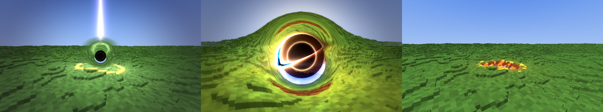
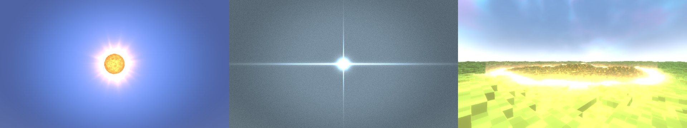

<div align="center">


# ✦ The Shooting Star — for Horizon

**Орбитальные удары, кинематографичные катсцены в космосе и аниме-кадры удара —
в Minecraft, переписанном на Rust.**

Порт мода [The Shooting Star (Demo) 1.5.2](https://www.curseforge.com/minecraft/mc-mods/the-shooting-star-demo)
(автор — **rimuru.dev**) на [Horizon](https://github.com/horizon-rust/horizon).

[Установка](#-установка) · [Управление](#-управление) · [Заклинания](#-заклинания) ·
[Что лучше оригинала](#-что-лучше-оригинала) · [Как это устроено](#-как-это-устроено) · [English](#english)

</div>

---

## ✦ Что это

Пульт **Stellar Remote** вызывает удары с орбиты. Пока удар готовится, камера
улетает в космос: Земля, Сатурн, Солнечная система, Млечный Путь, рельсовая
пушка в 58 000 световых лет. Потом возвращается к удару, и наступает конец
света: кратеры, лава, вольфрамовые шпили до неба, ударные волны.

Эффекты рисуют **собственные GLSL-шейдеры оригинала**. Они компилируются прямо
в игре через naga, встроенный в Horizon, и проходят ту же цепочку, что и в
Java-версии: проходы заклинания → блум → композит. Движение камеры в космосе
снято с кода оригинала 1.5.2 кадр за кадром.

Поверх шейдеров оригинала порт добавляет свои проходы: свет заклинаний ложится
на мир (`hz_glow`), ударные волны гнут воздух, а горячие кратеры дрожат маревом
(`hz_shock`), яркий блум тянется горизонтальными полосами. Шейдеры оригинала при
этом не тронуты и по-прежнему рисуют заклинания оригинала. Шестое и седьмое заклинания,
**SS-H1 · Event Horizon** и **SS-H2 · Supernova**, сделаны самим портом: в оригинале rimuru.dev их нет.

<table>
<tr>
<td></td>
</tr>
<tr><td align="center"><b>SS-01 · Railgun</b> — от Земли до рельсовой пушки на краю Галактики и обратно</td></tr>
<tr>
<td></td>
</tr>
<tr><td align="center"><b>SS-03 · Gungnir</b> — кольцо-ускоритель у Юпитера разгоняет копьё</td></tr>
<tr>
<td></td>
</tr>
<tr><td align="center"><b>SS-04 · Seven Stars</b> — звёзды Большой Медведицы срываются с неба</td></tr>
<tr>
<td></td>
</tr>
<tr><td align="center"><b>SS-05 · Tesseract</b> — клетки, кубы в небе, гиперкуб; в катсцене — двигатель над сеткой пространства</td></tr>
<tr>
<td></td>
</tr>
<tr><td align="center"><b>SS-06 · Gravitia</b> — двадцать колец защёлкиваются вокруг Земли, и машина стреляет</td></tr>
<tr>
<td></td>
</tr>
<tr><td align="center"><b>SS-06 · Gravitia</b> — машина висит в небе над миром ещё сто секунд</td></tr>
</table>

## ✦ Установка

Нужен **[Horizon Launcher](https://github.com/horizon-rust/horizon)**. Всё делается в нём, без консоли:

1. **Моды → Добавить нативный мод с GitHub** → вставь ссылку
   ```
   https://github.com/Oxyg1/shooting-star-horizon
   ```
   → **Добавить с GitHub**.
2. **Собрать** (производительная сборка). Первая сборка занимает 20–30 минут, следующие — минуты.
3. **Играть** → зайди в любой мир. Мод сам скачает оригинал с CurseForge
   (≈145 МБ, прогресс виден над хотбаром), соберёт из него контент и
   напишет в чат, когда закончит. Эффекты работают сразу.
4. **Перезапусти игру** — появятся пульт **Stellar Remote**, блоки и звуки
   (в креативе или `/give @s shooting_star_demo:stellar_remote`).

Обновление — кнопка **Обновить** в том же списке модов.

> В репозитории **нет ни одного файла оригинала**. Мод скачивает их у тебя
> на компьютере с CurseForge и сверяет контрольные суммы, как если бы ты
> скачал мод сам.

<details>
<summary><b>Установка одной командой (без окна лаунчера)</b></summary>

Делает то же самое, включая сборку. Windows (PowerShell):

```powershell
irm https://raw.githubusercontent.com/Oxyg1/shooting-star-horizon/main/install/install.ps1 | iex
```

Linux / macOS:

```bash
curl -fsSL https://raw.githubusercontent.com/Oxyg1/shooting-star-horizon/main/install/install.sh | bash
```

</details>

<details>
<summary><b>Если CurseForge недоступен или катсцен нет</b></summary>

* **CurseForge недоступен:** задай переменную `SHOOTING_STAR_MIRROR` — адрес
  папки с теми же двумя jar. Мод проверит их по SHA-256. Для прокси
  используется `HTTPS_PROXY`.
* **Катсцен нет:** для их таблиц нужна Java 25. Она появляется вместе с
  любой версией 26.x в Horizon Launcher или Minecraft Launcher. После её
  установки мод сделает таблицы при следующем запуске.
* Скачанный оригинал (≈145 МБ) хранится в `horizon-mods/.horizon-mod-data/shooting_star/original`,
  чтобы обновления не качали его снова.
* Удаление: `horizon-launcher mods remove shooting_star`, затем папки
  `horizon-mods/shooting_star_demo` и `horizon-mods/.horizon-mod-data/shooting_star` в папке игры (`%APPDATA%\horizon` или `~/.local/share/horizon`).

</details>

## ✦ Управление

| Клавиша | Действие |
|---|---|
| **ПКМ** с пультом | каст выбранного заклинания |
| **Shift + ПКМ** | следующее заклинание |
| **H** | меню пульта: выбор заклинания (семь), мощность, урон, скорость, клавиши, качество эффектов FX, безопасный режим «Land» (колесо, стрелки) |
| **J** | пропустить катсцену; если её нет — включить или выключить катсцены |
| **K · I · U · Y · O · B · V** | SS-01 · SS-03 · SS-04 · SS-05 · SS-06 · SS-H1 · SS-H2 |
| **N · M · Z** | мощность · скорость · урон выбранного заклинания (с Shift — вниз) |
| `/tss undo` | вернуть землю, изменённую вашим последним заклинанием |

Клавиши меняются в меню пульта (H) или в Options → Mods → The Shooting Star.

**`/tss undo`** возвращает землю, изменённую вашим последним заклинанием. Для каждого
игрока хранятся последние три заклинания, кроме Gravitia; заклинание должно сначала
закончиться. Земля возвращается за несколько тиков, затем над хотбаром появляется «The land is
restored». Ограничения: ориентация блоков и содержимое сундуков и других контейнеров не
восстанавливаются, блоки возвращаются в состоянии по умолчанию.

Пятая кнопка меню, «Land: On/Off», включает безопасный режим. При «Off» заклинания
играют все эффекты и наносят урон как настроено, но не меняют блоки: нет кратеров и
обломков. Настройка хранится в файле настроек пульта и отправляется на сервер. Она же
запрещает изменение мира у Gravitia.

Кнопка **FX** в меню пульта (H) задаёт качество эффектов: Low / Med / High / Ultra
(ПКМ — назад). Настройка хранится в файле настроек пульта.

* **Low** — эффекты до 720p и только проходы оригинала, без дополнительных проходов порта.
* **Med** — эффекты до 1080p.
* **High** (по умолчанию) — бюджет оригинала (≈3,7 Мп) и все дополнительные проходы.
* **Ultra** — полное разрешение и более сильные полосы света.

Кнопка «Катсцены» в меню теперь называется «Фильмы».


## ✦ Заклинания

| | Что делает | Катсцена |
|---|---|---|
| **SS-01 · Railgun** | через ≈17,6 с луч радиусом 200 вырезает цилиндр от неба до пустоты, бедрок тоже | ✅ космос, пушка, погоня |
| **SS-03 · Gungnir** | игла с орбиты: кратер 88×108, трещины лавы, вольфрамовый шпиль до неба, ударная волна | ✅ Юпитер, кольцо, полёт |
| **SS-04 · Seven Stars** | семь звёзд Ковша падают по очереди: кратеры с кристаллами и светящиеся траншеи | ✅ созвездие, залп |
| **SS-05 · Tesseract** | квадрат 640×640: 64 куба земли поднимаются в небо волнами, над ними поворачивается гиперкуб | ✅ сетка пространства, двигатель |
| **SS-06 · Gravitia** | кольцевая машина собирается вокруг Земли, бьёт, и мир навсегда становится Imaginary Space — город в пустоте под космическим небом. Нужен **второй клик** за 10 с | ✅ Земля, сборка машины, выстрел |
| **SS-H1 · Event Horizon** (клавиша **B**, оранжевый) — **своё заклинание порта, в оригинале rimuru.dev его нет** | спутник, сжатый в микро-чёрную дыру, падает с высоты 220 блоков, зависает над землёй и съедает идеально круглый шар мира (размер зависит от мощности), затягивает мобов, игроков и блоки, сжимается и испаряется белой вспышкой. Шар остаётся пустым, его край сплавлен в обсидиан, плачущий обсидиан, магму и чёрный камень и остывает около минуты. Свет вокруг дыры изгибается по-настоящему: фон линзируется, видны кольцо Эйнштейна и дальняя сторона диска | ✅ своя катсцена в мире: падение, облёт, коллапс, вспышка |
| **SS-H2 · Supernova** (клавиша **V**, бледно-голубой) — **своё заклинание порта, в оригинале rimuru.dev его нет** | звезда загорается в 300 блоках над целью, разбухает в красного гиганта, схлопывается и взрывается. Ударный фронт кольцом идёт по земле и выжигает её: трава, листья, цветы и снег сгорают, трава становится грубой землёй и землёй, песок стеклом, под звездой земля сплавляется в стекло, тонированное стекло, базальт и светящуюся магму. Радиус выжженной земли зависит от мощности. После взрыва около минуты стоит день, на небе светится туманность-остаток с вращающимся пульсаром | ✅ своя катсцена в мире: звезда, гигант, коллапс, фронт над землёй |



**SS-H1 · Event Horizon** подробнее. Всё в нём нарисовано и озвучено портом, файлы оригинала не используются: звук синтезирован портом (см. ниже «Звук SS-H1 и SS-H2»), картинка карточки в меню нарисована для порта.

* Порядок: кольца на земле с 0,5 с, падение с 3,5 с, посадка на 6,5 с, дыра ест мир с 8 по 15 с, вспышка около 17 с.
* Падающий спутник оставляет фиолетовый след. После посадки диск аккреции раскручивается.
* Вырванные блоки взлетают и по спирали уходят в дыру падающими блоками, которые исчезают.
* Перед вспышкой дыра сжимается в ничто, мир на миг становится серым. Вспышка: шар света, две струи из полюсов, ударный фронт.
* Свет искривляется: лучи трассируются по кривому пути, поэтому мир за дырой линзирован, как в «Интерстеллар».
* Камера катсцены следит за падением, облетает дыру, пока она ест, наезжает при коллапсе и показывает вспышку общим планом. На посадке и на вспышке рисуются аниме-кадры удара.
* Пока дыра ест, картинка вокруг неё смазывается в её сторону (свет затягивает), место темнеет, будто свет утекает в неё, свет, выбирающийся из колодца, выходит краснее, а из полюсов бьют две слабые мерцающие струи.



**SS-H2 · Supernova** подробнее. Как и SS-H1, всё в нём нарисовано и озвучено портом, файлов оригинала нет. Мощность 0,25–10 меняет радиус выжженной земли: 90 блоков при мощности 1, от 30 до 280.

* Порядок: на 1,5 с над целью в 300 блоках загорается звезда (точка света с дифракционными лучами); с 3 по 11 с она разбухает в красного гиганта с кипящей поверхностью, пятнами, короной и протуберанцами и пульсирует (каждый пульс трясёт экран); на 11 с схлопывается в сине-белую точку, мир теряет цвет; на 12,5 с взрыв: белая вспышка, лазурные аниме-кадры удара, оболочка света; на 13 с взрыв достигает земли, и ударный фронт кольцом идёт от центра, за ним стена пыли.
* Фронт выжигает землю: трава и листья, цветы и снег сгорают, трава становится грубой землёй или землёй, песок становится стеклом, под звездой земля сплавляется в стекло, тонированное стекло, базальт и светящуюся магму. Край только опалён.
* Мобы и игроки на пути фронта получают урон (по настройке урона) и отбрасываются наружу. Игрока толкает, и он слышит, как фронт проходит.
* После взрыва около минуты ночь превращается в день (небо светится, мир ярче), в небе светится туманность-остаток с вращающимся пульсаром и угасает примерно за минуту. В выжженной земле тлеют угли.
* Катсцена в мире: наверху у звезды, гигант над холмами, крупный план его кипящей поверхности, линза схлопывается вместе с коллапсом, фронт идёт на камеру низко над землёй, затем подъём над выжженной землёй под дневным небом.

**Звук SS-H1 и SS-H2.** Все звуки обоих заклинаний синтезирует сам порт (генераторы, шум, фильтры, свёрточная реверберация; `tools/sounds/synth.py`) в собственное пространство имён контент-мода `ss_port`: 17 звуков, ≈2,8 МБ. Ванильных звуков Minecraft и файлов оригинала нет. Крупные моменты слышны «в голове» (стерео), тем громче, чем ты ближе, как музыка Gravitia в оригинале; детали (рвущаяся скала, остывающий край, горящая земля) звучат в мире.

* Event Horizon: взвод, раздавленный спутник, трёхсекундный рёв падения, обрывающийся на посадке, суббас посадки, девятисекундный гул питания, который нарастает с ускоряющимися гравитационными биениями и обрывается в коллапс, вой коллапса, обрезанный тишиной, вспышка (белый треск, самый глубокий провал, звенящий аккорд, долгий гул), вырываемые камни, остывающий край.
* Supernova: хрустальные звоны взвода, мерцание зажигания, восьмисекундное бесконечно растущее нарастание с пульсами, имплозия в тишину, взрыв с хором света, стена ветра фронта, треск горения, рассветный хор.

## ✦ Что лучше оригинала

* **16-битный HDR между проходами** вместо 8-битного: свечение без полос.
* **Полное разрешение эффектов до 1440p.** Оригинал понижал его уже выше 2,3 Мп.
* **Gravitia не сработает случайно**: нужен второй клик за 10 секунд.
* **Установка одной кнопкой в лаунчере**: мод сам достаёт файлы оригинала при первом запуске.
* **Свет заклинаний ложится на мир** (`hz_glow`): блоки вокруг луча рейлгана, кратера и лавы Gungnir, каждой звезды Seven Stars, гиперкуба Tesseract, диска и вспышки Event Horizon, звезды и фронта Supernova освещены цветом заклинания.
* **Ударные волны гнут воздух** (кольцо рефракции от каждого удара), горячие кратеры дрожат маревом (`hz_shock`).
* **Анаморфные полосы света** из самого яркого блума (High и Ultra).
* **Аниме-кадры удара центрируются на точке удара** на экране, а не на середине экрана (SS-01/03/04/05; каждая посадка Seven Stars — на своей звезде).
* **Настройка качества FX** (Low / Med / High / Ultra) в меню пульта.
* **Безопасный режим** («Land: On/Off») и **`/tss undo`**: заклинания можно смотреть без разрушений или вернуть землю после них.
* **Прогрев шейдеров:** после входа в мир все шейдеры, текстуры и модель Gravitia готовятся в фоне по одному за кадр, поэтому первый каст не подвисает.

## ✦ Как это устроено

```
native/       код порта на Rust (native-мод Horizon, horizon-mixins)
  runtime.rs    окно: клавиши, меню, HUD, звук, режиссёр катсцен
  spells.rs     сервер: касты, таймлайны, вырезание земли, урон
  visuals.rs    что рисовать в этом кадре (StarFx, GungnirFx, SevenStarsFx)
  films.rs      космические сцены по таблицам 1.5.2
  cutscenes.rs  пути камеры катсцен (Shot, Cutscene, CutsceneDirector)
  tesseract.rs  SS-05: квадрат, кубы, гиперкуб, двигатель, катсцена
  gravitia.rs   SS-06: кольцевая машина, небо, купола, катсцена, звук
  glsl.rs       GLSL оригинала → naga (раскладка uniform-ов, sampler2D, порядок функций)
  render.rs     цепочка на wgpu: кадр мира → проходы → блум → композит
  setup.rs      первый запуск: скачать оригинал, собрать контент-мод, снять катсцены
  data/         свои файлы контент-мода, манифест файлов оригинала, рекордер катсцен
install/      установщики одной командой
tools/films/  снимает uniform-ы катсцен с классов оригинала (запускается установщиком)
```

Подробно об изменениях — в [CHANGELOG.md](CHANGELOG.md), об игре — в [docs/ГАЙД.md](docs/ГАЙД.md).

## ✦ Права

* **Оригинальный мод** — © rimuru.dev, All Rights Reserved. Его файлы не
  распространяются через этот репозиторий: установщик скачивает их с
  CurseForge на твой компьютер. Если ты автор и хочешь что-то изменить —
  открой issue.
* **Код порта** (всё в этом репозитории) — [MIT](LICENSE).
* Текстуры Земли, Луны, планет и Млечного Пути в оригинале — NASA / ESA
  (см. [NOTICE.md](NOTICE.md)).

---

## English

**The Shooting Star for Horizon** ports rimuru.dev's *The Shooting Star (Demo)
1.5.2* to [Horizon](https://github.com/horizon-rust/horizon), Minecraft Java
Edition rewritten in Rust. The spells, their world-scale destruction and
their space cutscenes are drawn by the original's own GLSL shaders. Horizon's
naga compiles them in-game, and they run in a 16-bit HDR chain on wgpu.

This repository holds only the port's code. Add it in Horizon Launcher
(Mods → Add a native mod from GitHub → `https://github.com/Oxyg1/shooting-star-horizon`),
build, and enter a world: the mod downloads the original from CurseForge and
builds its content mod on your machine; restart once. Or, from a terminal:

```powershell
irm https://raw.githubusercontent.com/Oxyg1/shooting-star-horizon/main/install/install.ps1 | iex   # Windows
```
```bash
curl -fsSL https://raw.githubusercontent.com/Oxyg1/shooting-star-horizon/main/install/install.sh | bash   # Linux/macOS
```

The port adds two spells of its own, SS-H1 Event Horizon (key B) and SS-H2 Supernova
(key V), which are not part of rimuru.dev's original mod, plus extra light, shock-wave
and light-streak passes and an FX quality setting (Low / Med / High / Ultra) in the
remote's menu. Both are scored with sounds the port synthesises itself (no vanilla
Minecraft sounds, no original files). The menu also has a safe-mode button ("Land:
On/Off": spells play all effects but change no blocks), and `/tss undo` restores the
land changed by your most recent spell. The original's own shaders still draw the
original's spells.

Port code: MIT. Original mod: © rimuru.dev, all rights reserved.
